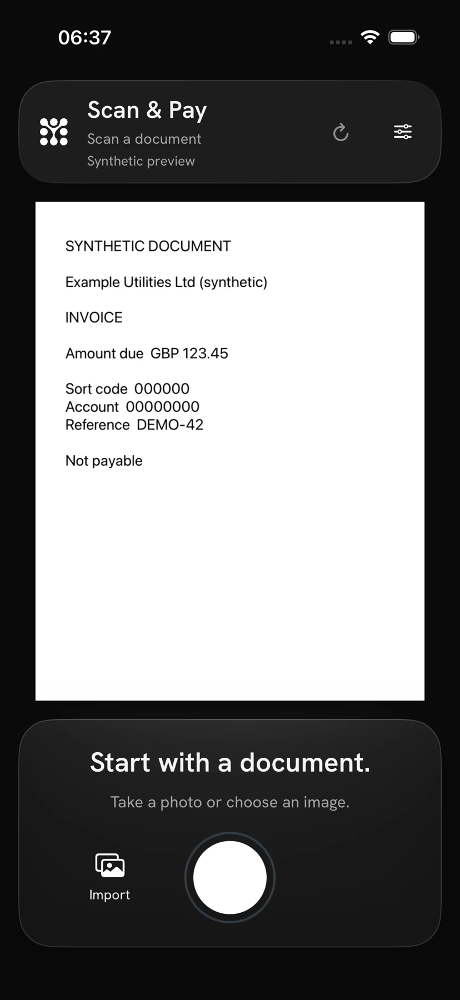
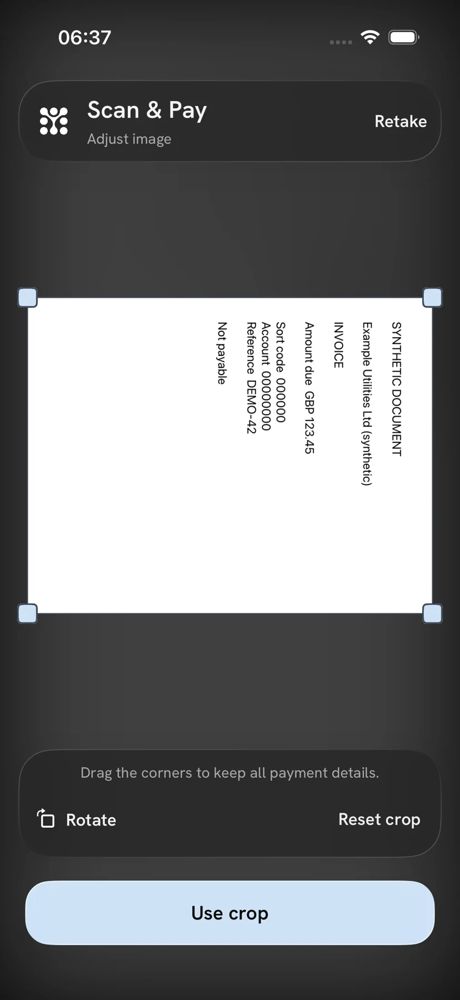
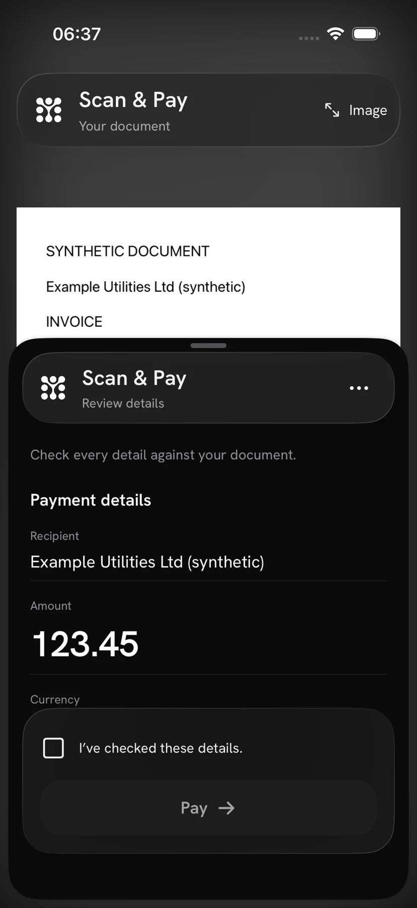
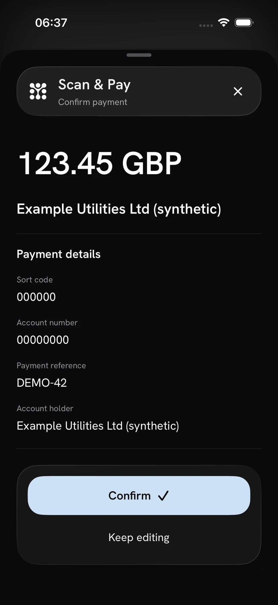
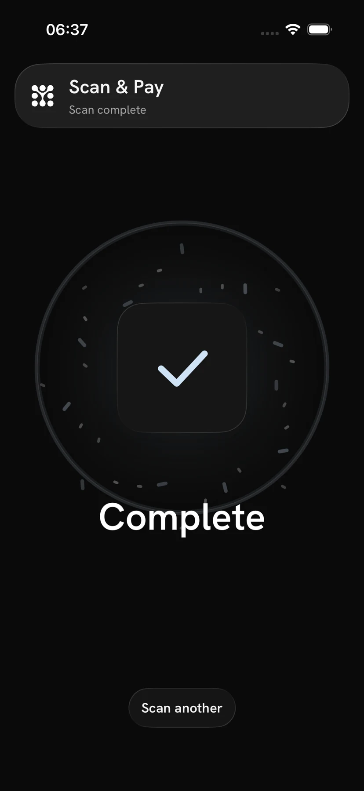
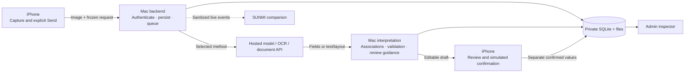
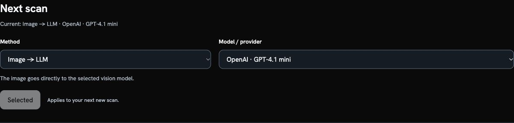
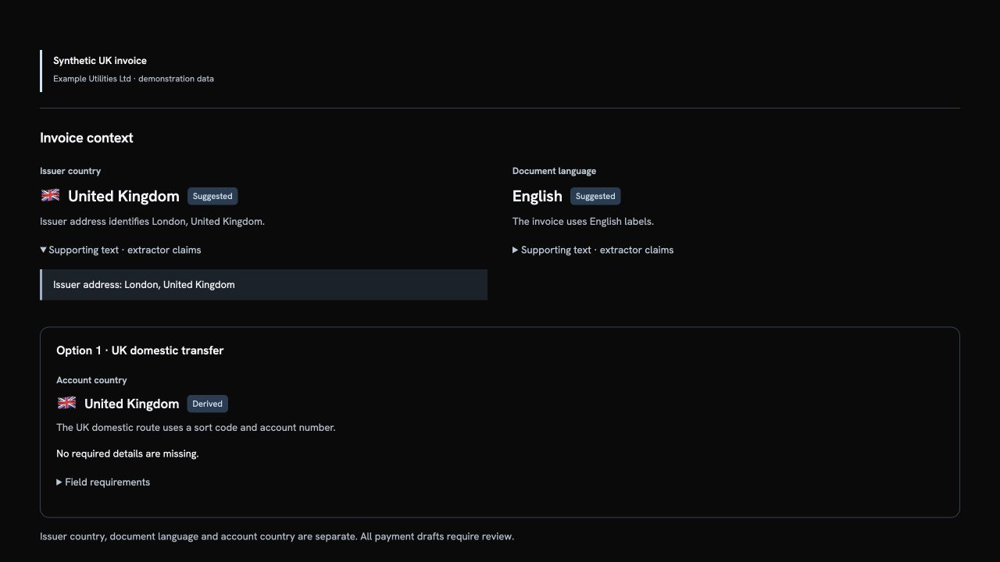
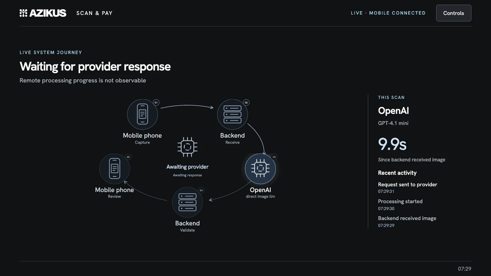

# Scan & Pay

### From a paper invoice to a reviewed payment draft.

Scan & Pay is an Azikus proof of concept that combines native iPhone capture, configurable AI/OCR extraction and an editable review experience. A local Mac backend coordinates processing and keeps the original result separate from the user's corrections. An admin inspector and SUNMI companion make the same journey visible to an operator and the room.

**Capture → Adjust → Send → Review → Confirm**

> Confirmation saves a reviewed draft. It does not execute a payment or move money.

[The mobile experience](#the-mobile-experience) · [How extraction works](#how-extraction-works) · [Admin](#the-admin-inspector) · [Live display](#the-live-companion) · [Run locally](#run-locally) · [Technical docs](#technical-docs)

## The mobile experience

The app keeps the document close to the fields throughout the journey. Dark Liquid Glass controls, native sheets and a reduced-motion alternative make capture, editing and confirmation feel like one continuous flow.

<table>
  <tr>
    <th>1 · Capture</th>
    <th>2 · Adjust</th>
    <th>3 · Review</th>
  </tr>
  <tr>
    <td align="center"></td>
    <td align="center"></td>
    <td align="center"></td>
  </tr>
</table>

**Capture.** Point the camera at the paper and hold steady. Apple Vision identifies the document, greys the surrounding preview and triggers automatic capture. The app straightens the image and opens **Adjust image**. Manual shutter and photo import remain available; detection runs on the phone.

**Adjust and send.** Crop or rotate the document, return to the full original photo, or retake it. After **Use crop**, the final preview offers **Send**. That explicit action uploads the image to the Mac. The app shows **Preparing image…**, then the processing state and field placeholders while it waits for the result.

**Review.** The returned draft appears in an expandable sheet with the document visible above it. Check the recipient, amount, currency, account and reference against the image. Edit a value or add missing details; corrections are marked **Edited**. Missing required fields and uncertainty remain visible, while optional empty fields are kept under **Add other details**.

<table>
  <tr><th>4 · Confirm</th><th>5 · Continue</th></tr>
  <tr>
    <td align="center"></td>
    <td align="center"></td>
  </tr>
</table>

**Confirm.** Check the review box and tap **Pay** to open the summary. **Keep editing** returns to the draft; **Confirm** saves the reviewed values separately on the backend. Useful incomplete drafts may be confirmed with visible warnings in this PoC. Empty/error results and drafts without a selected candidate remain blocked.

**Continue.** A successful save shows the completion animation, clears the mobile draft and returns to capture. The backend retains the original extraction and the confirmed review.

*These are actual application screenshots using explicitly synthetic invoice data. They illustrate the interface, not extraction accuracy. Click a screenshot to inspect it at full size. The capture fixture does not demonstrate live document detection.*

## How extraction works

The phone handles capture and review. The Mac handles authenticated requests, provider orchestration, field normalization and persistence. Hosted providers receive only the payloads required by the selected method.

A scan uses one exact, versioned profile. The admin's choice applies to the **next new Send**; it cannot change a draft that is already uploading, being processed or waiting for review.

| Method | What happens | External payload |
| --- | --- | --- |
| Direct image model | A hosted vision model returns structured fields from the invoice | Image plus extraction instructions/schema |
| OCR + rules | A service returns text/layout; local rules assemble the draft | Image to OCR; rules run on the Mac |
| Document API | An invoice/document service returns fields that an adapter maps into the shared contract | Image |
| OCR + annotations | A document service extracts against a requested field schema | Image plus schema |
| OCR → model | OCR runs first; a separate model interprets the returned content | Image to OCR, then text/layout to the model |

Supported integrations include OpenAI, Gemini, Mistral, Anthropic, Together, xAI, Google Document AI, Azure Document Intelligence, AWS Textract and Mindee. Actual model availability depends on the locally enabled configuration and account access. The [provider guide](docs/DEVELOPMENT.md#providers-and-extraction-profiles) explains profiles, data destinations and request outcomes.

## What the draft understands

The shared contract keeps payment details linked rather than collecting disconnected strings:

| Information | Handling |
| --- | --- |
| Recipient and account holder | Separate observations; the invoice issuer is not automatically the bank-account owner |
| Amount and currency | Decimal/digit strings; amount role and uncertainty remain explicit |
| UK bank transfer | Sort code and account number stay paired, including leading zeroes |
| IBAN transfer | IBAN/BIC and the associated reference stay with the same payment option |
| Croatian payment reference | Model and poziv na broj remain distinct and linked to the candidate |
| Document context | Issuer country, language and bank-account country stay separate |
| Missing or conflicting values | Preserve useful fields, show review reasons, and allow correction |

Country-aware guidance explains which fields are required for the detected payment route. For example, a UK domestic transfer uses sort code/account number rather than an IBAN. The original JSON retains explicit nulls and evidence even when the UI hides optional blank rows.

Format checks, an IBAN checksum or model confidence do not verify the recipient or prove the extraction correct. The document and the user's review remain essential.

## The admin inspector

The admin is served by the same backend at **`http://127.0.0.1:8000/admin`**. It uses the existing local bearer token.

Choose **Method → Model / provider → Use for next scan**. This updates the shared selection without sending an invoice. Mobile/automated filters make individual scans easy to find.

For each saved scan, the inspector can show the exact mobile upload, normalized original JSON, retained provider outputs, country/route guidance and separately confirmed mobile values. Viewing records does not rerun extraction. The screenshots above contain a method selector and synthetic UK context, without private scan records.

## The live companion

The SUNMI companion follows real mobile/backend activity: capture, upload, queued work, provider requests/responses, review and saved confirmation. It shows the selected provider, observed backend elapsed time and recent journey events. Invoice pixels, account details and edited values stay off the shared display.

Two display modes are available:

- **Vision Pro mode:** AirScreen receives headset mirroring on the main panel while the companion uses the customer panel.
- **Scan & Pay mode:** the main panel shows the technical journey and the smaller panel shows simplified status.

The idle view shows the website QR. **Controls → Next scan** offers the same shared method/model selection as the admin. Reconnect restores live observation; it cannot submit a scan. A provider response is an observed event, not proof of a correct draft. The capture above comes from an isolated QA session; live integration is separately accepted on hardware.

See [companion setup](docs/SETUP.md#sunmi-build-connection-and-displays) for installation and display placement.

## Recovery without duplicate scans

The phone saves pending image bytes, request options, profile/version, idempotency key, accepted scan ID and edits. An accepted scan resumes polling after an interruption. An uncertain upload can be recovered explicitly with the same request; repeated acceptance returns the original scan.

Confirmations also have a stable UUID and frozen body. If saving is interrupted, recovery uses that same confirmation rather than writing a second review. Backend identity checks protect recovery when the Mac address changes. A newer result cannot reopen a discarded draft.

Reconnect, polling, inspection and display observation do not trigger provider calls. A deliberately new request key creates a new run. An unsent capture is held in memory and must be retaken after an app relaunch.

## Run locally

The physical setup uses the iPhone's **Personal Hotspot** and one saved Mac address. Connect the Mac to the hotspot, open admin **Connection**, copy its address into the app's **Connection → Hotspot → Mac address**, and tap **Reconnect**. Keep the Mac awake. The phone's `localhost` is the phone itself.

A fresh checkout needs Python 3.12, hash-locked dependencies, a private `.env`, enabled provider profiles and an iOS build. The [setup guide](docs/SETUP.md) covers these steps and safe use of an existing installation. The admin and live display require no separate frontend service.

## Scope

This is a working local PoC for single-image capture, extraction and human review. The backend accepts JPEG/PNG; the iOS app uploads an oriented PNG. It does not execute payments, decode payment QR/barcode payloads or accept multipage/HEIC API uploads. The Android capture app is outside this delivery; the Android-based SUNMI display companion is supported.

Extraction can be wrong or incomplete. Reviewed development measurements and their limits are in the [evaluation guide](docs/EVALUATION.md). No production accuracy, latency or availability guarantee is implied.

## Technical docs

| Read | Purpose |
| --- | --- |
| [Setup](docs/SETUP.md) | Backend, credentials, hotspot and local operation |
| [API contract](docs/API_CONTRACT.md) | Wire semantics, typed observations and review endpoints |
| [Evaluation](docs/EVALUATION.md) | Corpus runs, scoring, measurements and known limitations |
| [Development](docs/DEVELOPMENT.md) | Architecture, providers, repository map and checks |

[Setup](docs/SETUP.md) owns native/display build instructions; [Development](docs/DEVELOPMENT.md) covers their implementation. The existing [25-slide deck](presentation/README.md) and [Webflow showcase](website/README.md) remain available; this guide is the product overview.

Screenshot source descriptions and hashes are in [asset provenance](website/assets/provenance.json). Real invoices, credentials, labels, raw provider responses and generated exports remain outside Git.
