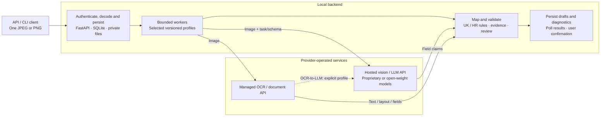

# Architecture and data destinations

Current consumers are the native iOS app and authenticated admin inspector. The admin's Next scan form chooses an exact enabled direct-image, OCR/rules or OCR→LLM profile; the persisted selection is Mistral Small at this checkpoint. The historical Phase 2 OpenAI baseline remains documented in [closeout](PHASE2_CLOSEOUT.md). See [mobile checkpoint](MOBILE_CHECKPOINT.md) for accepted behavior and [reorganization handoff](REPOSITORY_REORGANIZATION_HANDOFF.md) for the next structural change.

Mobile edits and source metadata live separately from immutable extraction records. The inspector reads saved provider responses and exact mobile upload bytes through authenticated endpoints; it does not initiate inference. Backend identity supports safe USB/Wi-Fi reconnection of pending drafts. Frontend/backend remain one local deployment; Android and subsequent features follow the jointly prepared presentation.

The dated architectural notes below retain their original context; earlier "later mobile" and "unvalidated hybrid" descriptions are historical.

Updated 7 October 2026. The implemented backend accepts one image and returns separate, reviewable payment drafts. See [implementation status](IMPLEMENTATION_STATUS.md) for measured provider results.

Adapters in `backend/adapters/` handle provider requests and responses. `backend/document_observations.py` retains normalized OCR/document observations; local rules and mapping produce the common payment contract. `backend/review.py` applies shared consistency checks. `evaluation/` provides full-corpus execution, saved-response replay and expense summaries. OCR → OpenAI text composition is now offline-tested with separate reservations and recipients; see [M3 interpretation](M3_INTERPRETATION.md). Fresh validation remains M3 work.

Inference runs through provider-operated APIs. Self-hosted model servers and weight downloads are excluded. The unused original handoff PNG is preserved privately under `.local/archive/pre-main-*/docs/assets/`; the editable diagram above is the current architecture reference.

## Reading the flow

1. An API/command-line client uploads a JPEG/PNG now. Later the native iOS and Android apps call the same service. A developer's API client is not the customer-facing conference UX.
2. FastAPI validates/authenticates input, prepares a canonical oriented image and persists an idempotent job/profile snapshot in SQLite. A bounded worker dispatches approved stages with a spend reservation. Start with one process, not a distributed queue.
3. Extract chooses one pipeline. Compare runs selected profiles independently; it does not merge their votes. Vision receives an image; managed OCR/document services receive an image; An explicitly enabled OCR→LLM profile sends whitelisted text/line layout to a second recipient; the current composition is offline-tested and awaits fresh validation. Only configured stages execute.
4. Local adapters map observations; UK/HR rules preserve route/amount/reference association, normalize safely and compute review reasons. Language/address are supporting hints, not sufficient account-country evidence. A model claim is not bank verification.
5. Private results, stage events, timings, usage and destination records persist locally. Polling returns the common contract. Every draft requires review/confirmation. No user corrections are counted as raw extraction accuracy.

## Stage-level data map

| Profile/stage | What leaves the machine | Recipient | What stays local |
| --- | --- | --- | --- |
| Direct vision | Canonical/provider rendition plus task/schema | Selected OpenAI, Anthropic, Google, Mistral or other enabled provider-operated endpoint, using proprietary or open-weight models | Input hashes, normalized draft, diagnostics, raw response if retained |
| Managed OCR → local rules | Image to OCR; rules send nothing | Selected Mistral/Azure/Google OCR endpoint | Returned text/layout, UK/HR logic, validation |
| Prebuilt document API | Image | Azure Invoice, Google Invoice Parser, Textract or configured commercial API | Raw mapping, missing-field handling, validators |
| OCR → LLM, offline-tested | Image to OCR, then text/layout (and image only in an explicitly named variant) to model | Two separately recorded services | Stage association and total/individual costs |
| Local rules | Nothing by themselves | None for the local stage | Mapped fields from OCR observations |
| Native OCR, mobile phase | Depending on agreed profile, image plus image-linked observations to this backend | Backend, then only configured provider stages | Device work is measured separately |

Every external stage records actual service/host, account alias, configured region, known/unknown processing residency, payload classes, hashes/renditions and request ID. A local server is not local-only processing; text can contain the same sensitive details as the original image. No model/SDK may introduce an undisclosed remote fallback. Account retention/training settings are verified at integration, not assumed from provider branding.

## Persistence and operational boundary

- SQLite: jobs, run/stage status, idempotency, profile/version snapshots, costs and data-destination metadata.
- .local/: private inputs, renditions, raw responses and evaluation labels. Curated source samples stay in samples/ and are never cleanup targets.
- Atomic acceptance before dispatch; completed results survive restart. Nonterminal work becomes interrupted and is not automatically replayed. DELETE rejects active work, removes local terminal artifacts and retains a minimal idempotency tombstone; it cannot erase upstream retention.
- Default loopback binding and local bearer token. Native device access later needs deliberately configured LAN address/security; phone localhost is not laptop localhost.
- Bounded concurrency, timeouts, explicit retry policy, cost reservations and unknown-charge handling. No provider probes or model downloads at startup.

## Later consumers, not first-milestone work

Native mobile capture/review is designed before implementation, iOS first. The attendee companion later reads safe job/stage events and masks private fields; it is separate from the customer flow. Final HTML findings use measured evaluation outputs and clearly labelled limitations. Neither is needed to get this backend working.

The current diagram is editable documentation. Final findings and the [separate cost report](COST_REPORT_PLAN.md) are distinct deliverables.

The user-requested private progress explainer is `reports/overview-2026-10-07/index.html`. It summarizes implementation and processing outcomes; the final findings report and attendee companion remain later deliverables.
